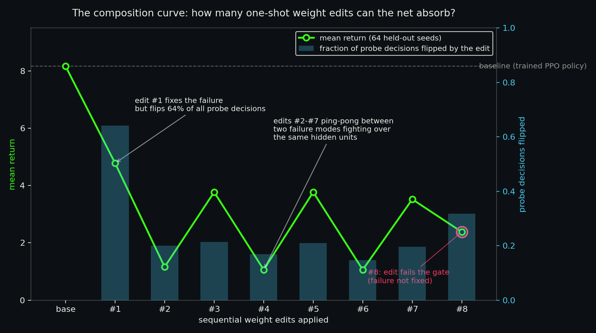
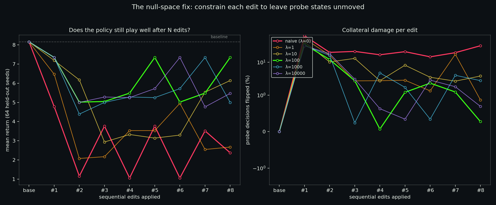
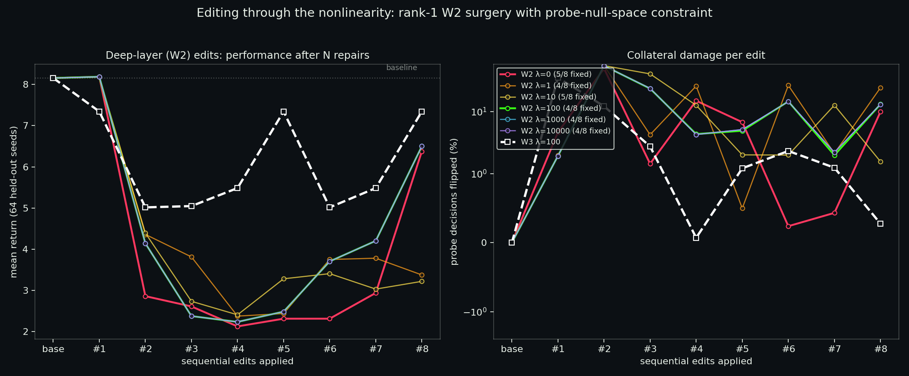
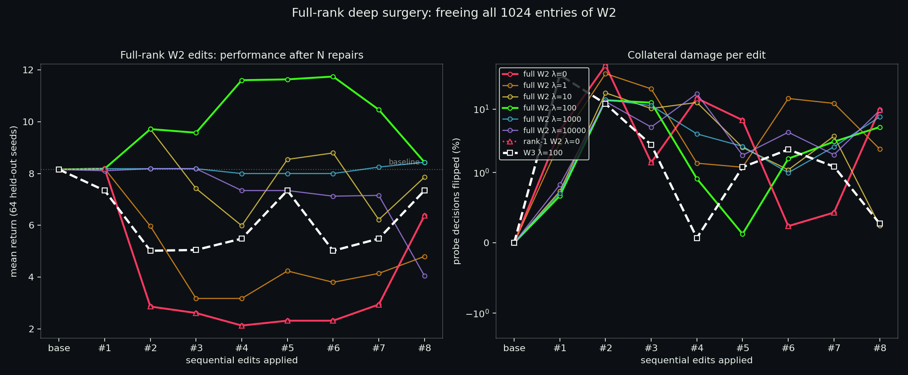

# KimiBrainSurgery

**An automated failure → diagnose → repair → verify loop that edits a neural network's weights directly — no retraining, no gradients — and measures how many repairs the network can absorb.**

The patient: [`GridPolicyMLP`](https://huggingface.co/HarleyCooper/grid-policy-mlp), a 17,253-parameter PPO-trained Breakout policy (500→32→32→5, tanh). Companion to the [live visualizer](https://harleycoops.github.io/breakout-policy-visualizer/).

---

## The loop

Like an RL gym, except the training signal is *failures*:

1. **MINE** — greedy rollouts over 200 seeds. A *failure* is the exact decision node where a descending ball's landing column (computed by exact forward simulation, wall bounces included) flips from coverable to uncoverable because of the chosen paddle action.
2. **DIAGNOSE** — the final layer is linear in the hidden state (`logits = h2 @ W3 + b3`), so the fatal logit gap decomposes *exactly* into per-hidden-unit contributions. Arithmetic, not attribution heuristics.
3. **SOLVE** — a closed-form minimal edit to `W3` that flips the decision at the failure state.
4. **GATE** — regression battery: is the failure fixed? How many of ~20k probe-state decisions flipped? What did mean return on 64 held-out seeds do?
5. **ITERATE** — apply the edit, re-mine for the *next* failure, repeat. The composition curve is the output.

```bash
python failure_gym.py          # naive solver
python nullspace_gym.py 100    # null-space-constrained W3 solver, lambda=100
python w2_gym.py 100           # rank-1 constrained W2 solver, lambda=100
python fullrank_gym.py 100     # full-rank constrained W2 solver, lambda=100
python monotonic_gym.py 100    # full-rank + keep/rollback gate; writes best_weights.npz
```

Numpy only. Each run reproduces its report cards in a couple of minutes.

## Experiment 1 — naive minimal-norm edits

`W3[:, wrong] −= c·h2`, `W3[:, save] += c·h2` — the smallest edit that fixes the failure, ignoring every other state.



**The net absorbs zero clean edits.** Edit #1 fixes its failure but flips 64% of all probe decisions as collateral damage; mean return halves immediately. Edits #2–#7 ping-pong between a left-edge and a right-edge miss whose culprit hidden units overlap — each repair steals back the margin the previous one spent. Edit #8 fails the gate outright.

## Experiment 2 — the null-space fix

Constrain the repair: minimize `‖d‖² + λ·‖H·d‖²/N` subject to `d·h2_failure = gap + margin`, where H stacks the hidden states of thousands of probe states. Closed form: `d ∝ (I + λ·HᵀH/N)⁻¹·h2`. λ=0 is the naive edit; large λ forces the repair into directions the rest of the policy is insensitive to.



| λ | failures fixed | return after 8 edits (baseline 8.16) | median probe damage per edit |
|---|---|---|---|
| 0 (naive) | 7/8 | **2.38** | 20.5% |
| 1 | 6/8 | 2.67 | 2.8% |
| 10 | 6/8 | 6.14 | 6.0% |
| **100** | **8/8** | **7.34** | **1.8%** |
| 1000 | 8/8 | 5.00 | 3.4% |
| 10000 | 8/8 | 5.47 | 2.3% |

At **λ=100** the loop repairs all 8 failures in sequence — including the second, third, and eighth failures the naive solver either caused or couldn't fix — with ~2% collateral damage per edit and 90% of baseline performance retained after eight sequential surgeries.

## Experiment 3 — deeper cuts: editing W2 through the nonlinearity

Readout-layer edits are easy mode: `logits = h2 @ W3 + b3` is *linear* in W3, so the fix and its containment are exact. The real question is whether surgery works on a layer whose output passes through `tanh` before reaching the logits.

`w2_gym.py` answers it with a rank-1 edit `ΔW2 = h1_failure · gᵀ`. For any state, `Δz2 = (h1·h1_failure)·g` exactly and `Δh2 ≈ diag(1−h2²)·Δz2` to first order — so the probe-protection matrix is *diagonal* and the constrained solve is still one line. A trust region (max ‖ΔW2‖ per step) plus Newton refinement handles the linearization error.



| λ | failures fixed | return after 8 edits | median probe damage | median Newton steps |
|---|---|---|---|---|
| 0 (naive rank-1) | 5/8 | 6.38 | 5.7% | 1 |
| 1 | 4/8 | 3.38 | 14.2% | 4 |
| 10 | 5/8 | 3.22 | 7.3% | 5 |
| 100 | 4/8 | 6.50 | 9.0% | 5 |
| 1000 | 4/8 | 6.50 | 9.1% | 5 |
| 10000 | 4/8 | 6.50 | 9.1% | 5 |
| *W3, λ=100 (for contrast)* | *8/8* | *7.34* | *1.8%* | *— (exact)* |

Three honest findings:

1. **Deeper surgery is genuinely harder.** Best-case W2 fixes half the failures W3-constrained fixes, with ~5× the collateral damage. The diagnosis lives in h2 space, but a W2 edit *changes h2 itself* — you are operating on the feature you measured with.
2. **The λ sweep saturates**: λ=100, 1000, 10000 produce identical curves because the trust region, not the constraint, becomes the binding limit. Once linearization error dominates, buying more probe protection no longer helps.
3. **Naive rank-1 W2 (λ=0) beats naive W3** (5.7% vs 20.5% median damage): rank-1 edits couple to other states only through h1-similarity, which is naturally sparse. Structure can substitute for constraints — a hint that the right *parameterization* matters as much as the right penalty.

## Experiment 4 — full-rank W2: surgery that makes the policy *better than it was*

The rank-1 restriction was the prime suspect for W2's underperformance. `fullrank_gym.py` frees all 1024 entries of ΔW2. The closed form survives: with `vec(ΔW2)` stacking columns, the probe penalty is block-diagonal per output unit (`G_j = (1/N)Σ_p D_p[j]² h1_p h1_pᵀ`), so the constrained solve is 32 small linear systems, not one 1024×1024 one. Trust region + Newton refinement as before.



| λ | failures fixed | return after 8 edits (baseline 8.16) | median probe damage |
|---|---|---|---|
| 0 | 5/8 | 6.38 | 5.7% |
| 1 | 4/8 | 4.80 | 7.7% |
| 10 | 6/8 | 7.86 | 3.1% |
| **100** | 4/8 | **8.44** (peak **11.75** after edit #6) | **2.4%** |
| 1000 | 2/8 | 8.44 | 3.3% |
| 10000 | 0/8 | 4.05 | 4.8% |
| *W3 λ=100 (contrast)* | *8/8* | *7.34* | *1.8%* |

**The composition curve inverts.** At λ=100 the sequential edits don't just avoid damage — they compound: 8.16 → 8.19 → 9.72 → 9.58 → 11.61 → 11.64 → **11.75**, +44% over the trained baseline after six surgeries, with ~2% probe damage per edit. The loop stops behaving like repair and starts behaving like *training by other means*: each diagnosed failure is a curriculum item, and each closed-form edit is a lesson that sticks.

Three honest observations:

1. **The gate and the game disagree, in both directions.** Edits #1–#3 at λ=100 are marked `fixed=False` — the exact failure state's argmax never entered the saving set (tanh saturation shrinks the constraint direction, and 8 trust-region steps can't reach it) — yet return *rose* through them. Partial fixes that move the decision boundary toward the saving action still improve play even when the binary gate says "not fixed."
2. **It still ends in interference.** Edit #8 (a re-mined variant of the seed-12 right-edge miss from #2/#3) knocks return from 10.47 back to 8.44. The ping-pong failure mode from Experiment 1 is down, not out.
3. **λ is now a capability knob, not just a safety knob.** λ=10000 fixes nothing (constraint strangles the edit) but also preserves performance; λ=100 fixes fewer binary gates than W3 yet produces the best-playing network this project has ever had. "How many edits can it absorb" was the wrong question for deep layers — the right one is "what does the policy become."

## Experiment 5 — the monotonic loop: surgery that can only help

`monotonic_gym.py` adds the keep/rollback rule to the full-rank solver: an edit is applied only if gated mean return does not decrease, otherwise it is rolled back and the failure is marked **unresolved** — reported, never silently dropped. Previously repaired failures are retested after every kept edit, and a stall is reported as a *solver* stall, not proof of exhausted capacity. Because the evaluation is deterministic (greedy play, fixed seeds), the rule is exact.

Result at λ=100: 3 of 4 proposed edits kept, one rolled back (the persistent seed-12 right-edge miss), and the run ends because the miner finds **no new avoidable failures** in 200 seeds. The composition curve is monotonic *on the measured gate* — a finite gate can miss regressions elsewhere, so the run closes with an untouched held-out evaluation on seeds never used for mining or gating:

| | gate seeds (used in loop) | held-out seeds (never seen) |
|---|---|---|
| original | 8.16 | 8.56 |
| repaired (3 kept edits) | **9.83** | **9.06** |

The gain generalizes. The repaired weights are published as
[`grid-policy-mlp-repaired`](https://huggingface.co/HarleyCooper/grid-policy-mlp-repaired),
and the [live visualizer](https://harleycoops.github.io/breakout-policy-visualizer/) has a
weights selector so you can watch the original and repaired policies play side by side.

### Paired per-seed verification (1,000 held-out games)

`paired_eval.py` replays both checkpoints on the same held-out games (seeds 20000–20999,
greedy, never mined or gated on) and stores every per-seed score in
`eval/paired_heldout.json`. Exact checkpoints, hashed for reproduction:

| checkpoint | sha256 (first 16) |
|---|---|
| `policy_weights.npz` (original) | `d3cd5623fdae730f` |
| `best_weights.npz` (repaired) | `9c338f7c08c9590a` |

Results over 1,000 paired games:

| metric | value |
|---|---|
| baseline mean return | 8.69 |
| repaired mean return | 9.77 |
| paired difference | **+1.08 ± 3.74 (sd)** |
| bootstrap 95% CI on diff | **[+0.85, +1.31]** |
| wins / losses / ties | **137 / 0 / 863** |
| sign test p | < 10⁻⁴ |

The picture is unambiguous: the repaired policy is **never worse on any of 1,000 games**
and strictly better in 137 of them — a strict stochastic improvement, concentrated in the
games where the original policy had the specific failure the gym repaired. (An earlier
64-game pilot showed the same shape — 4/0/60 — but with a CI that barely excluded zero;
the larger set tightens the estimate from +0.50 [+0.02, +1.20] to +1.08 [+0.85, +1.31].)

## Experiment 6 — chasing the last failure, and finding the miner's blind spot

The monotonic loop left one failure unresolved (the seed-12 right-edge miss; its W2 edits
all tripped the gate). `chase_unresolved.py` attacks it with a solver grid — W2 and W3,
λ ∈ {10, 100, 1000}, margin ∈ {0.1, 0.5, 1, 2} — gated on return as usual. Every W2 config
fails to fix it; **every W3 null-space config fixes it** (the readout layer was the right
tool for this one). Best: W3 λ=10, return 9.83 → 9.95. One more monotonic W2 step on top
reaches 10.06 gated. Those weights are `best_weights_v3.npz`
([grid-policy-mlp-repaired-v3](https://huggingface.co/HarleyCooper/grid-policy-mlp-repaired-v3)).

But the 1,000-game paired eval surfaces what the gate missed:

| model | mean (1000 held-out) | wins / losses / ties vs original |
|---|---|---|
| original | 8.69 | — |
| v1 (published) | 9.77 | 137 / **0** / 863 |
| v3 | **10.53** | 137 / **17** / 846 |

All 17 v3 losses are the same game shape: baseline scores 13, v3 scores 0. Tracing one
(seed 20021): the original policy pre-positions the paddle while the ball is *ascending*;
v3 has unlearned that habit, so by the time the ball descends the miss is already
unavoidable. **The miner only inspects descending balls, so failure-to-pre-position is a
structural blind spot** — the failure happens at a node the failure definition never visits.
The fix for the last descending-ball failure cost an ascending-ball behavior, and no part
of the mine → diagnose → solve loop could see it. Only the paired eval could.

v1 stays the flagship release: never worse on 1,000 games is a stronger guarantee than
+0.76 more mean with 17 catastrophic regressions. Extending the miner to ascent-phase
positioning failures is the open problem.

## Experiment 7 — closing the blind spot: the flight miner

Experiment 6 ended with a structural admission: the miner only watched *descending* balls,
so failing to pre-position the paddle during ascent was invisible. The fix is exact
simulation: since the paddle only interacts with the ball at row 8, the ball's entire
flight — ascent, brick bounces, wall bounces, brick removals — is deterministic given the
current state. `flight_landing()` in `failure_gym.py` simulates it to the next row-8
arrival, and `mine(use_flight=True)` flags ANY decision node (ascent included) where the
chosen action makes that arrival uncoverable. The 13→0 seeds that yielded zero failures
under the descent miner immediately produce clean failure cards (e.g. seed 20021 step 1:
"ball will land col 8, paddle center 2, policy chose no-op — right saves it").

A monotonic run from v3 with the flight miner keeps 6 of 12 edits and produces **v4**:

| model | mean, seeds 20000-20999 | mean, seeds 30000-30999 (fresh) | W/L/T (fresh) |
|---|---|---|---|
| original | 8.69 | 8.89 | — |
| v1 | 9.77 | — | never worse |
| v3 | 10.53 | — | 17 losses |
| **v4** | **12.18** (+3.49) | **12.19** (+3.30) | 253 / 20 / 727 |

The fresh-set numbers match the contaminated set within noise — no gate overfitting.

**But the blind-spot class itself resists repair.** A solver grid aimed directly at the
seed-20021 ascent failure (W2 and W3, λ ∈ {10, 100, 1000}) fixes the state every time —
and loses 1.5-2.6 gated return doing it: 460-2,300 probe decisions flip for one ascent
state. The failure is *detectable* but not *cheaply correctable* by closed-form edits.
v4 still carries the 13→0 class (~2% of games). The loop's verdict: detection is solved;
correction needs either richer edits (multi-state batch constraints) or a parameter
budget the readout/deep layers don't have. That is now the sharpest open question in the
repo.

## Why it matters

Weight-space editing promises behavior as inspectable, addressable mathematics: find the numbers responsible, change exactly those, verify nothing else moved. Experiment 1 shows the naive version of that promise fails even on a toy network — knowledge is stored in shared, overlapping features, so unconstrained edits are never local. Experiment 2 shows the fix is also mathematical: the same linear structure that makes failures diagnosable makes collateral damage *compressible into a constraint*. Diagnosis and containment come from the same equation. Experiment 3 marks the current boundary: at the readout layer the loop is exact and composes; one nonlinearity deeper, the measurement instrument and the edit start interfering with each other.

Honest caveats: 17k parameters, greedy-play evaluation, W2/W3 edits only (W1 is untouched). Whether the loop scales to larger models is the open question — the gym is the instrument built to ask it.

## Layout

| Piece | What it is |
|---|---|
| `failure_gym.py` | Mine → diagnose → solve → gate → iterate, naive solver |
| `nullspace_gym.py` | Same loop, ridge-constrained (null-space) W3 solver; λ from argv |
| `w2_gym.py` | Rank-1 probe-constrained W2 solver with trust region + Newton refinement |
| `fullrank_gym.py` | Full-rank constrained W2 solver via block-diagonal Gram structure |
| `monotonic_gym.py` | Full-rank solver + keep/rollback gate, regression retests, held-out final eval |
| `chase_unresolved.py` | Solver-grid attack on the one failure the monotonic loop rolled back |
| `paired_eval.py` | Paired per-seed held-out eval with bootstrap CI + sign test |
| `plot_nullspace.py`, `make_gym_figure.py`, `plot_w2.py`, `plot_fullrank.py` | Figure generators |
| `assets/game.py`, `assets/policy.py` | Authoritative deterministic Breakout physics + policy wrapper |
| `assets/policy_weights.npz` | The trained GridPolicyMLP weights (17,253 params) |
| `results_nullspace_*.json`, `results_w2_*.json`, `results_fullrank_*.json`, `results_monotonic_*.json` | Raw run records for all sweeps |
| `best_weights.npz` / `best_weights_v3.npz` | The repaired checkpoints (v1 = never-worse; v3 = max mean, 17 regressions) |
| `eval/paired_heldout*.json` | Paired per-seed held-out scores, 1000 games |

*Physics engine from [weight-space-breakout](https://app.primeintellect.ai/dashboard/environments/harleycooper/weight-space-breakout) (MIT). Built with [Kimi](https://kimi.com).*
